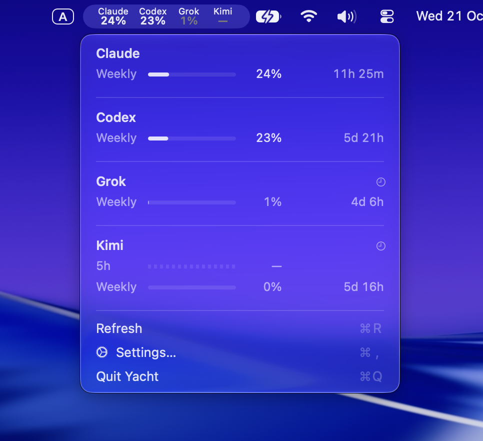
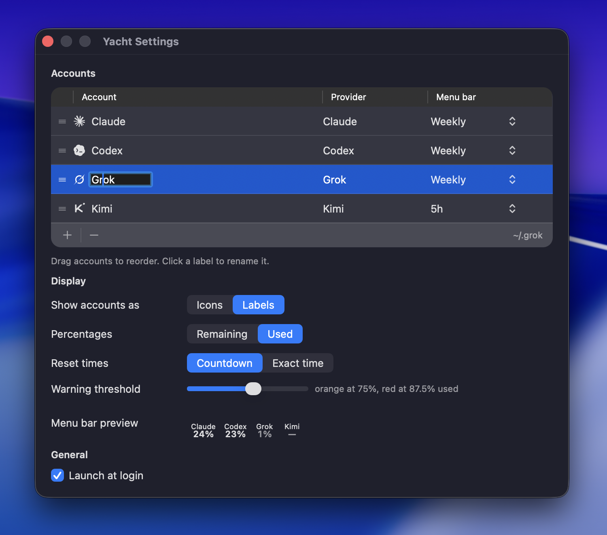

<h1>Yacht</h1>

A macOS menu bar app that shows rate-limit usage for coding agents.
Multi-account friendly, built in native Swift and AppKit.

[](https://github.com/rengwu/yacht/releases/latest/download/Yacht.dmg)



## Features

- Four providers side by side — **Claude Code**, **Kimi Code**, **Codex CLI**, and **Grok**
- [Multiple accounts](#running-multiple-accounts) per provider, each pointed at its own config or
  home directory (standard profile folders for all four providers are auto-discovered;
  any folder can be added by hand)
- One chosen quota window per menu bar entry, or **Off**; all reported windows remain in the dropdown
- Labels above figures or monochrome provider icons beside figures
- Used or remaining percentages; countdowns or local reset times
- One warning threshold, with the critical threshold derived halfway to 100%
- Drag to order accounts; editable labels; compact stale, awaiting-update, and no-data states
- Launch at login



The current design and implementation notes are in [the project wiki](docs/wiki/index.md).

## Requirements

- macOS 13+, on Apple Silicon or Intel
- For Claude accounts: Claude Code installed and logged in, with `jq` available to its shell
  (for example, `brew install jq`).
- For Kimi accounts: Kimi Code installed and logged in. Yacht reads the existing access token;
  use the CLI to renew an expired session.
- For Codex accounts: the `codex` CLI installed and logged in. Yacht asks it for usage;
  the CLI handles authentication, and Yacht does not read or write its credential files directly.
- For Grok accounts: the `grok` CLI installed and logged in. Yacht reads that account's session
  token and asks grok.com for the same weekly usage bar the TUI's **Usage limit** tab shows. It
  never writes `auth.json` and never refreshes the token.

## Install

1. [Download Yacht.dmg](https://github.com/rengwu/yacht/releases/latest/download/Yacht.dmg).
2. Open the DMG and drag **Yacht** into **Applications**. Quit an older running copy before replacing it.
3. Open Yacht from Applications. Settings opens automatically when no accounts are registered.

The app is ad-hoc signed, not notarized. If macOS blocks a download you trust, try opening it
once, then use **System Settings → Privacy & Security → Open Anyway**, as described in
[Apple's first-launch instructions](https://support.apple.com/en-ph/102445).

Upgrading preserves your registered accounts and settings.

## Build

Building from source requires Xcode Command Line Tools and Swift 5.9+; full Xcode is not required.

```
./build.sh
```

Builds a universal release binary and assembles an ad-hoc-signed `build/Yacht.app`.
The bundle version comes from [`VERSION`](VERSION), currently **0.2.0**.
Move it to `/Applications` (or run it in place) and launch it like any other
app.

To build with a specific version stamped into the bundle:

```
./build.sh 1.2.0
```

## Usage

1. Launch the app — it lives entirely in the menu bar (no Dock icon).
2. Click the menu bar item → **Settings…**.
3. Under **Accounts**, click **+**, choose the provider, then pick that account's
   folder. Registration is always explicit: finding a provider's files on disk never creates an
   account on its own. Discovered folders offer **Use** shortcuts in the sheet.
4. Finish the provider-specific step below.

Reopening Yacht opens Settings. This also gives access if a crowded menu bar hides the
status item; set some accounts' menu bar window to **Off** to reduce its width.

All settings persist to
`~/Library/Application Support/Yacht/config.json`.
Existing accounts and thresholds are retained. Older text-template and icon preferences remain
in the configuration for compatibility, but the native interface uses the new Display controls.

### Claude

Select the account, then click **Install Tap** in the table footer. This writes the tap script to
`~/Library/Application Support/Yacht/` and points that account's `settings.json`
`statusLine` at it, preserving every other key already in the file. If another status
line command is already installed, the app tells you rather than overwriting it
silently. Usage data appears after Claude Code's next turn for that account.

### Kimi

Nothing to install — register the Kimi Code home folder (`~/.kimi-code` by default) and Yacht
polls Kimi for that account. It uses the existing session's access token without changing it; if
that token has expired, the account shows a stale clock or no-data dash. Hover its label for the
reason; use `kimi` again to renew the session.

### Codex

Nothing to install per account. Yacht finds the `codex` binary itself. If it cannot resolve one,
Settings offers **Locate Codex executable…**. Existing configured paths are preserved, and one
executable serves every Codex account.

### Grok

Nothing to install. Register the Grok home folder (`~/.grok` by default) and Yacht polls grok.com
for that account's weekly usage pool — the same figure `/usage` draws as **Weekly limit**. It uses
the existing session's access token without changing it; if that token has expired, a stale clock or
no-data dash appears. Hover the label for details, and use `grok` again to renew the session.

## Running multiple accounts

Create another `~/.claude`-style folder and point `CLAUDE_CONFIG_DIR` at it —
Claude Code treats it as a separate account, prompting a fresh login on first
run:

```
CLAUDE_CONFIG_DIR=~/.claude-work claude
```

Name it `.claude<anything>` and Yacht's account discovery picks it up
automatically. For convenience, alias it in `~/.zshrc`:

```
alias claude-work="CLAUDE_CONFIG_DIR=~/.claude-work claude"
```

Kimi and Codex split accounts the same way, via `KIMI_CODE_HOME` and `CODEX_HOME`.
Codex discovery lists `~/.codex` and sibling folders named `.codex<anything>`, such as
`~/.codex-work`. Kimi discovery lists `~/.kimi-code` and sibling folders such as
`~/.kimi-code-work`, followed by older `.kimi*` folders containing
`credentials/kimi-code.json`. Choose custom folders elsewhere through **Add Account…**.
Grok uses `GROK_HOME`; folders named `.grok<anything>` are discovered the same way.

## How usage collection works

Each provider is a separate adapter, and one failing provider never disturbs another's numbers.

### Claude — a tap it pushes to

For Claude Code, Yacht installs a small script (the "tap") as the `statusLine`
command for each account you register. Claude Code can run that command on
every turn. The tap reads the status line's JSON payload from stdin and,
whenever it carries `rate_limits`, writes a snapshot to `usage-snapshot.json`
inside that account's Claude config directory. The app polls those snapshot
files and renders them in the menu bar and dropdown. This Claude adapter never
talks to the network.

The tap prints nothing, so it never appears as a visible status line. It exits `0` on errors
and writes snapshots atomically.

### Kimi — a read-only poll

Yacht reads the access token and expiry from that account's `credentials/kimi-code.json` and
asks Kimi's usage endpoint. It never writes that file and never refreshes the token —
Kimi rotates refresh tokens itself, and a competing writer
could log you out. An expired token therefore shows as expired rather than being renewed.

### Codex — its own binary, asked directly

Yacht runs `codex app-server` and makes one `account/rateLimits/read` request, so the figure comes
from the vendor's own code path rather than a re-implementation of it. Yacht never opens
`auth.json`; codex owns its own token. It also reads the modification time of the newest rollout
file under `CODEX_HOME/sessions` — never the contents — to tell an active session from an idle
one.

### Grok — the same weekly bar as `/usage`

Grok's TUI already fetches the weekly pool from
`https://cli-chat-proxy.grok.com/v1/billing?format=credits`. Yacht reads the access token already
sitting in that account's `auth.json` and asks the same endpoint, so the menu bar is
`creditUsagePercent` against the period's reset — not a reconstruction from local transcripts. It
never writes `auth.json` and never refreshes the token. An expired token therefore shows as expired
rather than being renewed.

### Refresh timing and saved readings

Kimi and Grok poll about once a minute while their saved tokens are unexpired. If credentials
are missing or expired, Yacht skips network requests and checks the local credentials every minute
for a renewed session. Codex polls about once a minute while a session has recent activity and
every 15 minutes while idle.

Opening the dropdown or choosing **Refresh** requests an immediate update; Kimi and Grok still
need valid credentials. When an update fails, the last known figure remains visible with a stale
clock. Stale figures dim unless they meet the warning threshold. Once a quota's reset time passes,
its figure becomes a dash until a fresh reading arrives.

## Development

```
swift build
swift run UsageCoreTests
bash tap/test_tap.sh
```

To inspect the native interface with eight fictional accounts and no provider requests or
configuration writes:

```
open -n build/Yacht.app --args --demo
```

Demo mode opens Settings; **Yacht → Usage Preview (Demo)** (⌘U) opens the same native usage
menu beside it. Add `--light` or `--contrast` to inspect light or high-contrast light appearance
without changing the system setting. Launch-at-login and tap installation are disabled in demo mode.

Tests run as a plain executable with the Command Line Tools toolchain.

Project layout:

- `Sources/UsageCore` — model, config, the four provider adapters
  (`SnapshotReader`/`TapInstaller` for Claude, `KimiProvider`, `CodexProvider`, `GrokProvider`),
  and view-model rendering. No AppKit dependency, so it's testable headless.
- `Sources/Yacht` — the app: status item, settings window, launch-at-login.
  A thin projection of `UsageCore`'s view model.
- `Tests/UsageCoreTests` — the test suite.
- `tap/claude-usage-tap.sh` — the Claude tap script, kept in sync with the copy
  embedded in `UsageCore` (test-enforced). Its legacy filename is intentionally
  stable because existing `statusLine` settings contain its absolute path.

## Releasing

Set `VERSION` to the new version and add matching notes at `docs/releases/<version>.md`.
Merge those changes into `main` and wait for CI to pass, then tag that commit:

```sh
git switch main
git pull --ff-only
release_version="$(cat VERSION)"
git tag -a "v${release_version}" -m "Release Yacht ${release_version}"
git push origin "v${release_version}"
```

This triggers `.github/workflows/release.yml`, which verifies the tag matches `VERSION`,
runs the core and tap tests, builds both CPU architectures, verifies the app signature,
packages it as a DMG, and publishes a GitHub Release with the
versioned DMG and an unversioned `Yacht.dmg` for the download link. Every push and PR to `main` also runs
`.github/workflows/ci.yml` (build + core and tap tests).
