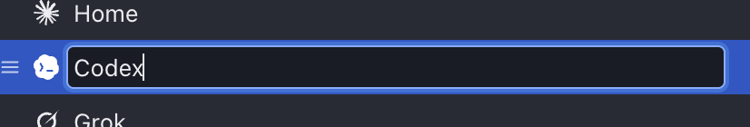
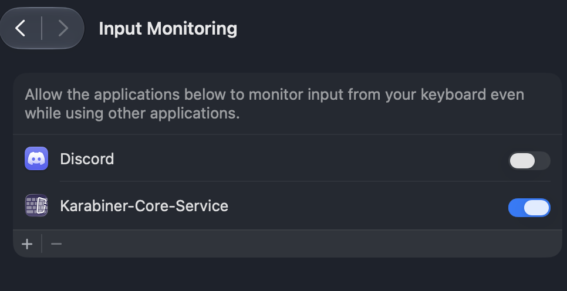

# Interview answers

Submitted answers; interpretation and accepted decisions are recorded through grill-me/plan.

Session: `38baa3c1-ee26-4927-a545-81600f42bc14`

[Saved visual review source](../attachments/2026-10-20-grill-38baa3c1-ee26-4927-a545-81600f42bc14-review.json)

Preview revision: `46979f503a19ae95761d1e802798686ac718d83e99be5eace88c7dd231fff893`

## Question 1

```text
Round: Yacht accounts — two native table directions
Question: A · Compact table — what would you change?
Description (Markdown source):
Closest to your Sound settings reference: single-line rows, a quiet header, full-width selection, and a rounded group. The selected account’s folder appears in the bottom bar. Labels and menu-bar choices look like text until you interact with them.

These are browser mockups for a native Swift/AppKit implementation. They use fictional profiles and cannot change Yacht. Try the controls, or use **Comment on preview** to mark a specific area.
Recommendation:
Options:
Selected: (notes or adjustments only)
Notes: almost perfect. [Image #1]make it so that the name input field isnt full width all the time. it has a min width, and then grows with the inputted value.   use this exact table component [Image #2]
Status: feedback
Prototype states: {"main":{"accounts":[{"id":"work","label":"Work","provider":"Claude","path":"~/.claude-work","quota":"5h"},{"id":"home","label":"Home","provider":"Claude","path":"~/.claude-home","quota":"Weekly"},{"id":"grok","label":"Grok","provider":"Grok","path":"~/.grok","quota":"Weekly"},{"id":"kimi","label":"Kimi","provider":"Kimi","path":"~/.kimi-code","quota":"5h"},{"id":"sample-1","label":"Client","provider":"Claude","path":"~/.claude-client-1","quota":"5h"}],"selected":"sample-1","appearance":"dark","next":2}}
Comments: []
```





## Question 2

```text
Round: Yacht accounts — two native table directions
Question: B · Folder paths always visible — what would you change?
Description (Markdown source):
The same native table treatment, with a second line for every folder path. It is easier to distinguish several profiles at a glance, but rows take more space. The rounded group, subtle striping, plain labels, and quiet menu-bar controls match A.
Recommendation:
Options:
Selected: (untouched; no approval)
Notes:
Status: untouched
Prototype states: {}
Comments: []
```

## Question 3

```text
Round: Yacht accounts — two native table directions
Question: Which direction should we refine?
Description (Markdown source):

Recommendation: A is my recommendation: it follows your Sound settings reference most closely and stays compact with eight accounts. The selected folder remains one click away.
Options: A · Compact table / B · Folder paths always visible
Selected: A · Compact table
Notes:
Status: feedback
Prototype states: {}
Comments: []
```
